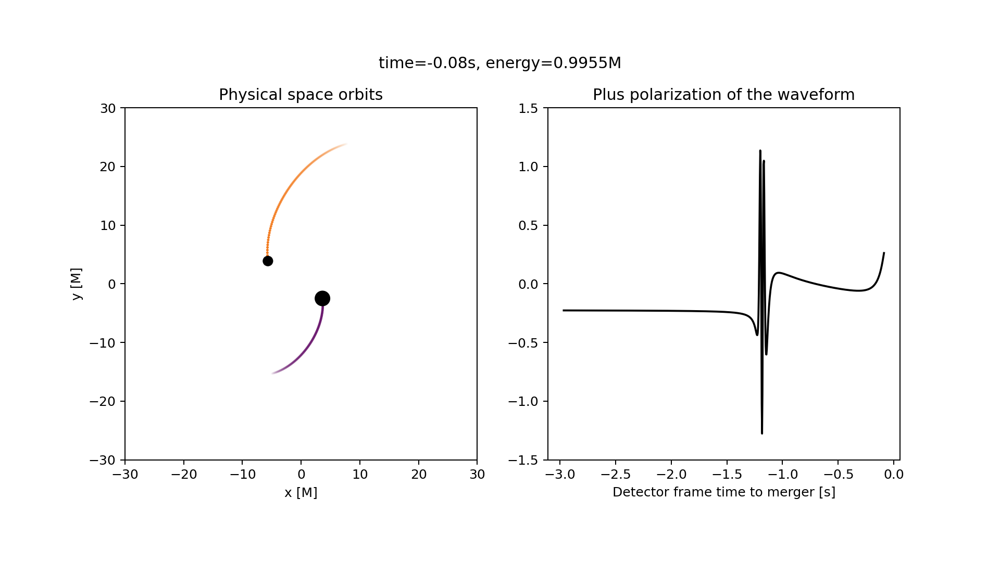

A video of black holes orbiting and merging, 
starting from their EOB description!

Videos made with this can be found at the following links:

- [Dynamical capture for GW190521](https://www.youtube.com/watch?v=xRF-Gc0voik)
- [Quasi-circular GW190521](https://www.youtube.com/watch?v=8FNCC3WeGyc)



## Posterior samples in Blender: `eobviz`

The `eobviz` package renders the EOB dynamics of a cloud of posterior samples, as
called in parameter estimation, in Blender, with the whitened strain below it.

- `eobviz/models/`: one `EOBRun` subclass per waveform model (`SEOBNRv5PHM`, `SEOBNRv4PHM`,
  `TEOBResumSDali`). Each reproduces the PE call and exposes the orbit, spins, remnant and
  ringdown in a common form; the base class has what is shared (ringdown fit, J(t → −∞),
  sky orientation).
- `eobviz/events/`: one `Event` subclass per event (`GW250114`, `GW190521`, `GW150914`):
  posterior, PE settings, render timeline, data and whitening for the panel.
- `eobviz/{ppd,export,camera,blender_scene,panel}.py`: the pipeline, the same for every event.
- `gw250114/`, `gw190521/`, `gw150914/`: per-event products, renders, validation scripts,
  Python environments and READMEs with the details.

From the repository root (each command switches to the event's environment by itself):

```bash
python -m eobviz events                              # events and their environments
python -m eobviz ppd GW150914                        # whitened PPD of the data
python -m eobviz export GW150914 --n-samples 200     # scene data of 200 samples (or --index I)
python -m eobviz camera GW150914 --name cloud200 [--shot orbit]
python -m eobviz render GW150914 --name cloud200 --style solid_highlight
python -m eobviz panel GW150914 --name cloud200      # panel frames, final video
python -m eobviz scene GW150914 --name cloud200      # open the scene in Blender
python -m eobviz scene GW150914 --name cloud200 --draft --max-samples 50   # fast, plain look
```

`scene` opens the event in Blender's GUI instead of rendering it. Scrub the timeline or
play it to move back and forth in time, and look through the animated camera (numpad 0)
or fly around freely. Timeline markers show detector time, the median merger and the
camera's shot changes; a text in the corner of the view (not rendered) shows the current
time. `render ... --save-blend` also saves the scene as `renders/<name>/scene.blend`.

For iterating on timing and camera, `--draft` (with `scene` or `render`) swaps the look for
plain coloured spheres and arrows in Workbench, with the trails cut to their last fraction
of an orbit instead of fading: about 0.2 s per rendered frame instead of ~5 s (frames go to
`renders/<name>_draft/`), and 16 fps of playback for 200 samples. `--max-samples N` shows only
N of the samples (and the max-likelihood one); with 50, draft playback is real time.

A new event needs an `Event` subclass (and a model class if its waveform model is new),
registered in `eobviz/events/__init__.py`.

## Usage (original GW190521 videos)

Information about the binary is contained in the `Event` class 
(within `maximum_likelihood_scenario.py`).

Once you define an event, you can plot it with the `plot_event` function
within `plots.py`.

This will generate a video of the EOB evolution brought into physical coordinates,
also showing the corresponding gravitational waveform.

The project is mostly targeted at visualizing the event GW190521,
which was [recently reanalyzed showing that it was likely a dynamical capture](https://www.nature.com/articles/s41550-022-01813-w).

## Technical info / installation

This was tested with `python3.11`, and the necessary packages
are:
`numpy astropy matplotlib scipy ffmpeg-python tqdm`

Also, you need `TEOBResumS`. To install the correct version, do:

```bash
git clone https://bitbucket.org/eob_ihes/teobresums
cd teobresums
git checkout eccentric.v0_a6c_c3_circularized
git cherry-pick e8cb333
cd Python
make
```

because a function we need is not in the eccentric model they used

Remember to 
```
export PYTHONPATH=$PYTHONPATH:~/path/to/teobresums/Python
```
